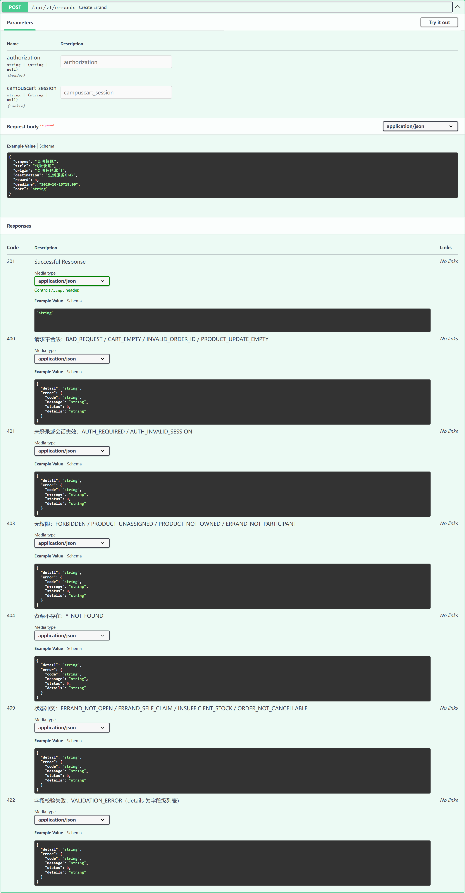

# API 字段合同 — 河南大学校园交易与互助平台

> 周期一 · 王少鹏 · 核心接口字段检查
>
> 本文件覆盖 **商品 / 订单 / 跑腿** 三类核心接口的请求与响应字段，
> 以及 400 / 401 / 403 / 404 / 409 / 422 的**统一错误格式**。
> 前后端以此文件为唯一字段依据；改字段先改本文件，再改代码。

## 1. 通用约定

| 项 | 约定 |
| --- | --- |
| Base URL | `http://localhost:8000` |
| 统一前缀 | `/api/v1` |
| 认证方式 | `Authorization: Bearer <token>`；也接受 Cookie `campuscart_session` |
| 请求体 | `Content-Type: application/json` |
| 时间字段 | ISO 8601 字符串，如 `2026-10-15T18:00` |
| 金额字段 | 数字（单位：元），前端展示为 `¥` |
| 交互式文档 | `/docs`（Swagger UI）、`/redoc`、`/openapi.json` |

## 2. 统一错误格式

所有 4xx / 5xx 响应体统一为下面的结构（由 `app/core/errors.py` 全局注册）：

```json
{
  "detail": "Product not found",
  "error": {
    "code": "PRODUCT_NOT_FOUND",
    "message": "Product not found",
    "status": 404,
    "details": null
  }
}
```

| 字段 | 类型 | 说明 |
| --- | --- | --- |
| `detail` | string | 人类可读消息。保留该字段以兼容既有前端 `services/api.js` 的 `data?.detail` |
| `error.code` | string | **机器可读错误码**，大写下划线，稳定不变，前端用它做分支判断 |
| `error.message` | string | 与 `detail` 完全一致 |
| `error.status` | int | HTTP 状态码，与响应行一致 |
| `error.details` | array \| null | 仅 422 返回字段级错误列表，其余为 `null` |

### 2.1 状态码与错误码

| HTTP | 语义 | 错误码 | 触发场景示例 |
| --- | --- | --- | --- |
| 400 | 请求不合法 | `BAD_REQUEST` / `CART_EMPTY` / `INVALID_ORDER_ID` / `PRODUCT_UPDATE_EMPTY` / `AUTH_EMAIL_REQUIRED` / `AUTH_PASSWORD_REQUIRED` / `AUTH_EMAIL_TAKEN` | 空购物车结算、订单 id 非法、更新体没有任何字段、登录/注册缺少邮箱或密码、邮箱已注册 |
| 401 | 未登录 / 会话失效 | `UNAUTHORIZED` / `AUTH_REQUIRED` / `AUTH_INVALID_SESSION` / `AUTH_UNREGISTERED` / `AUTH_INVALID_CREDENTIALS` / `AUTH_SESSION_INVALID` | 未带 token；token 被篡改或过期；未注册邮箱登录；密码错误 |
| 403 | 无权限 | `FORBIDDEN` / `PRODUCT_UNASSIGNED` / `PRODUCT_NOT_OWNED` / `ERRAND_NOT_PARTICIPANT` | 改别人的商品；非创建者/接单者去完成跑腿 |
| 404 | 资源不存在 | `NOT_FOUND` / `PRODUCT_NOT_FOUND` / `ORDER_NOT_FOUND` / `ORDER_ITEM_NOT_FOUND` / `ERRAND_NOT_FOUND` | 商品/订单/跑腿任务不存在 |
| 409 | 状态冲突 | `CONFLICT` / `ERRAND_NOT_OPEN` / `ERRAND_SELF_CLAIM` / `ERRAND_NOT_CLAIMED` / `INSUFFICIENT_STOCK` / `STOCK_CHANGED` / `ORDER_NOT_CANCELLABLE` | 重复接单；创建者接自己的单；库存不足 |
| 422 | 字段校验失败 | `VALIDATION_ERROR` | 缺必填字段、`reward < 0`、`qty < 1` |
| 500 | 服务端异常 | `INTERNAL_ERROR` / `AUTH_REGISTER_FAILED` | 未捕获异常（不向前端泄露堆栈）；注册写库失败 |
| 503 | 依赖服务不可用 | `AUTH_SERVICE_UNAVAILABLE` | 登录时 MongoDB 不可达 |

### 2.2 401 未登录

```json
{
  "detail": "Authentication required",
  "error": {
    "code": "AUTH_REQUIRED",
    "message": "Authentication required",
    "status": 401,
    "details": null
  }
}
```

### 2.3 422 字段校验（`details` 为字段级列表）

```json
{
  "detail": "请求参数校验失败",
  "error": {
    "code": "VALIDATION_ERROR",
    "message": "请求参数校验失败",
    "status": 422,
    "details": [
      {
        "field": "body.reward",
        "message": "Input should be greater than or equal to 0",
        "type": "greater_than_equal"
      }
    ]
  }
}
```

### 2.4 409 状态冲突

```json
{
  "detail": "Task is completed, not open",
  "error": {
    "code": "ERRAND_NOT_OPEN",
    "message": "Task is completed, not open",
    "status": 409,
    "details": null
  }
}
```

### 2.5 前端处理建议

```js
// services/api.js
const message = data?.error?.message || data?.detail || `HTTP ${res.status}`;
const code = data?.error?.code || null;
```

`detail` 仍是字符串，因此旧代码无需改动即可继续工作。

## 3. 商品接口（Products）

### 3.1 商品对象字段（响应）

| 字段 | 类型 | 必填 | 说明 |
| --- | --- | --- | --- |
| `id` | string | 是 | 商品 id（MongoDB `_id` 字符串化后输出） |
| `title` | string | 是 | 商品名称 |
| `category` | string | 是 | 分类，如 `书籍`、`数码产品`、`宿舍生活`、`出行工具` |
| `stream` | string | 否 | `book` / `digital` / `living` / `transport`，默认 `book` |
| `price` | number | 是 | 售价（元） |
| `originalPrice` | number \| null | 否 | 原价 |
| `mode` | string | 否 | `BUY` / `RENT` / `EXCHANGE`，默认 `BUY` |
| `condition` | string | 否 | 成色描述，默认 `几乎全新` |
| `stock` | int | 否 | 库存，默认 `1` |
| `campus` | string | 否 | 校区，默认 `金明校区` |
| `pickupLocation` | string | 否 | 建议交接点，默认 `图书馆门口` |
| `image` | string | 否 | 图片 URL |
| `description` | string | 否 | 描述 |
| `seller` | object | 否 | 卖家摘要：`name` / `email` / `avatar` / `trustScore` / `verified` / `department` |
| `sellerId` | string \| null | 否 | **服务端根据登录态写入**，前端传值会被覆盖 |
| `rentalRate` | string \| null | 否 | 租用价格（`mode=RENT` 时使用） |
| `exchangeWish` | string \| null | 否 | 期望交换物（`mode=EXCHANGE` 时使用） |
| `status` | string | 是 | `available` / `reserved` / `sold`，新建固定为 `available` |
| `created_at` | string | 否 | 服务端时间 |
| `updated_at` | string | 否 | 服务端时间 |

### 3.2 接口清单

| 方法 | 路径 | 认证 | 请求 | 成功响应 | 主要错误 |
| --- | --- | --- | --- | --- | --- |
| GET | `/api/v1/products` | 否 | Query：`stream` `category` `campus` `search` `status` `skip` `limit` | `200` `[商品对象]` | `422` `VALIDATION_ERROR`（`limit>100` 等） |
| GET | `/api/v1/products/{product_id}` | 否 | 路径参数 `product_id` | `200` 商品对象 | `404` `PRODUCT_NOT_FOUND` |
| POST | `/api/v1/products` | 是 | 商品创建体（`title`/`category`/`price` 必填，其余可选） | `201` 商品对象 | `401` `AUTH_REQUIRED`、`422` |
| PUT | `/api/v1/products/{product_id}` | 是 | `ProductUpdate`（全部字段可选，只更新传入字段） | `200` `{product, message}` | `400` `PRODUCT_UPDATE_EMPTY`、`403` `PRODUCT_UNASSIGNED` / `PRODUCT_NOT_OWNED`、`404` |
| DELETE | `/api/v1/products/{product_id}` | 是 | 路径参数 | `200` `{id, deleted, message}` | `403` `PRODUCT_UNASSIGNED` / `PRODUCT_NOT_OWNED`、`404` |
| POST | `/api/v1/products/seed` | 否 | Query：`force`（默认 `false`） | `200` `{message, seeded_count, product_ids}` | `422` |

> 说明：`stream` 的取值以 `book / digital / living / transport` 为准（与 `backend/app/data/initial_data.py` 的种子数据一致）。

### 3.3 创建商品请求示例

```json
{
  "title": "高等数学（同济第七版）",
  "category": "书籍",
  "stream": "book",
  "price": 18,
  "originalPrice": 58,
  "mode": "BUY",
  "condition": "九成新，少量笔记",
  "stock": 1,
  "campus": "金明校区",
  "pickupLocation": "金明校区图书馆门口",
  "description": "适合大一高数课程使用。"
}
```

## 4. 订单接口（Orders）

### 4.1 订单对象字段（响应）

| 字段 | 类型 | 说明 |
| --- | --- | --- |
| `id` | string | 订单 id |
| `buyer_id` | string | 买家 id（取自登录态） |
| `buyer` | object | `{ email, name }` |
| `items` | array | 订单快照，元素字段见下表 |
| `total` | number | 订单总额（元） |
| `status` | string | `Pending Pickup` / `Ready for Pickup` / `Completed` / `Cancelled` |
| `pickupToken` | string | 6 位自提凭证（大写 hex） |
| `pickupLocation` | string | 自提点 |
| `created_at` | string | 下单时间 |
| `cancelledAt` | string \| null | 取消时间（取消后出现） |

订单商品快照（`items[]`）字段：

| 字段 | 类型 | 说明 |
| --- | --- | --- |
| `id` | string | 商品 id |
| `title` | string | 下单时的商品名 |
| `price` | number | 下单时的单价 |
| `qty` | int | 数量，≥ 1 |
| `image` | string \| null | 图片 |
| `seller` | string \| null | 卖家名 |
| `sellerId` | string \| null | 卖家 id（服务端写入） |
| `pickupLocation` | string \| null | 自提点 |

### 4.2 接口清单

| 方法 | 路径 | 认证 | 请求 | 成功响应 | 主要错误 |
| --- | --- | --- | --- | --- | --- |
| GET | `/api/v1/orders` | 是 | 无 | `200` `[订单对象]` | `401` `AUTH_REQUIRED` |
| POST | `/api/v1/orders/checkout` | 是 | `{ "items": [ {id,title,price,qty,image?,seller?,pickupLocation?} ] }` | `200` 订单对象 | `400` `CART_EMPTY`、`404` `ORDER_ITEM_NOT_FOUND`、`409` `INSUFFICIENT_STOCK` / `STOCK_CHANGED`、`422` |
| POST | `/api/v1/orders/{order_id}/cancel` | 是 | 路径参数 | `200` `{id, status:"Cancelled"}` | `400` `INVALID_ORDER_ID`、`404` `ORDER_NOT_FOUND`、`409` `ORDER_NOT_CANCELLABLE` |

取消规则：仅 `Pending Pickup` 可取消；`Completed` / `Ready for Pickup` 返回 `409 ORDER_NOT_CANCELLABLE`；已取消的订单重复取消直接返回 `200`（幂等）。

结算在 MongoDB 事务内完成：扣减库存 → 写入订单 → 清空购物车 → 给卖家写通知。

## 5. 跑腿接口（Errands）

### 5.1 状态机

```
open ──claim(接单)──> claimed ──complete(完成)──> completed
  │                      │
  └── 409 ERRAND_SELF_CLAIM：创建者不能接自己的单
                         └── 409 ERRAND_NOT_CLAIMED：仅 claimed 可完成
                            403 ERRAND_NOT_PARTICIPANT：仅创建者/接单者可完成
```

### 5.2 跑腿对象字段

| 字段 | 类型 | 说明 |
| --- | --- | --- |
| `task_id` | string | 服务端生成，`task-` 前缀 + 12 位 hex |
| `creator_id` | string | 发布者（取自登录态，不信任客户端） |
| `claimer_id` | string \| null | 接单者；未接单为 `null` |
| `campus` | string | 校区，如 `金明校区` |
| `title` | string | 任务标题 |
| `origin` | string | 取件地 |
| `destination` | string | 送达地 |
| `reward` | number | 报酬（元），≥ 0 |
| `deadline` | string \| null | 可选截止时间，ISO 8601 |
| `status` | string | `open` / `claimed` / `completed` |
| `note` | string \| null | 接单/完成时的可选备注 |
| `created_at` | string | 服务端时间 |
| `updated_at` | string | 服务端时间 |

### 5.3 接口清单

| 方法 | 路径 | 认证 | 请求 | 成功响应 | 主要错误 |
| --- | --- | --- | --- | --- | --- |
| GET | `/api/v1/errands` | 否 | Query：`campus`、`status` | `200` `[跑腿对象]`（按 `created_at` 倒序） | — |
| POST | `/api/v1/errands` | 是 | `{campus,title,origin,destination,reward,deadline?,note?}` | `201` 跑腿对象（`status=open`） | `401`、`422` `VALIDATION_ERROR` |
| POST | `/api/v1/errands/{task_id}/claim` | 是 | 可选 `{note}` | `200` 跑腿对象（`status=claimed`） | `401`、`404` `ERRAND_NOT_FOUND`、`409` `ERRAND_NOT_OPEN` / `ERRAND_SELF_CLAIM` |
| POST | `/api/v1/errands/{task_id}/complete` | 是 | 可选 `{note}` | `200` 跑腿对象（`status=completed`） | `401`、`403` `ERRAND_NOT_PARTICIPANT`、`404`、`409` `ERRAND_NOT_CLAIMED` |

## 6. 认证接口（Authentication）

> 周期一整合说明：采用 PR #25 的「必须已注册才能登录」语义（Issue #11 要求），
> 历史自动创建的账号可以在「注册」页用同一邮箱认领并设置新密码，
> 详见 `docs/auth-legacy-accounts.md`。

### 6.1 接口清单

| 方法 | 路径 | 认证 | 请求 | 成功响应 | 主要错误 |
| --- | --- | --- | --- | --- | --- |
| POST | `/api/v1/auth/login` | 否 | `{email, password}` | `200 {success, token, token_type, message, user}` | `400` `AUTH_EMAIL_REQUIRED` / `AUTH_PASSWORD_REQUIRED`；`401` `AUTH_UNREGISTERED` / `AUTH_INVALID_CREDENTIALS`；`422`；`503` `AUTH_SERVICE_UNAVAILABLE` |
| POST | `/api/v1/auth/register` | 否 | `{email, password, name?, roll?, department?, campus?}` | `200 {success, token, token_type, message, user}` | `400` `AUTH_EMAIL_TAKEN`；`422`；`500` `AUTH_REGISTER_FAILED` |
| GET | `/api/v1/auth/me` | 是 | 无 | `200 {success, user}` | `401` `AUTH_REQUIRED` / `AUTH_INVALID_SESSION` / `AUTH_SESSION_INVALID` |
| POST | `/api/v1/auth/logout` | 否 | 无 | `200 {message}` | — |

### 6.2 UserProfile 字段

| 字段 | 类型 | 说明 |
| --- | --- | --- |
| `id` | string | 用户 id |
| `email` | string | 河南大学邮箱 |
| `roll` | string | 学号 |
| `name` | string | 姓名 |
| `department` / `dept` | string | 院系 |
| `campus` | string | 校区 |
| `hostel` | string | 宿舍 |
| `verified` | bool | 是否已认证 |
| `trustScore` | int | 信任分 |
| `created_at` / `last_login` | string \| null | 时间 |

### 6.3 密码与缓存约定

- 登录密码缺失或为空 → `400 AUTH_PASSWORD_REQUIRED`；注册密码缺失或为空 → `400`。
- 未注册邮箱 → `401 AUTH_UNREGISTERED`（不再自动开户）。
- 前端只缓存 token 与用户摘要，**不缓存密码**；登录成功后立即清空密码输入框。
- 登录请求期间按钮显示「正在验证…」，失败后保留邮箱与密码输入，方便直接重试。

## 7. 健康检查

| 方法 | 路径 | 响应字段 |
| --- | --- | --- |
| GET | `/api/v1/health` | `status`、`service`、`version`、`timestamp` |
| GET | `/api/v1/health/mongodb` | `status`、`database`、`db_name`、`products_count`、`connected`（失败时含 `error`） |

## 8. 字段检查结论（周期一）

1. **商品**：`stream` 默认值与示例原先写成 `engineering` / `medical`，与种子数据（`book/digital/living/transport`）不符，已修正；`campus`、`pickupLocation`、`condition`、`category` 等默认值原先仍是 Jadavpur / 英文示例，已统一为河南大学金明、明伦校区的中文默认值。
2. **订单**：`status` 保持英文枚举（`Pending Pickup` 等），因为前端 `OrderHistory` 依赖该枚举做状态机映射；已在本文档固定下来，不再改动。
3. **跑腿**：字段与状态机保持交付包三的合同，仅把错误码固定为 `ERRAND_*`。
4. **认证**：注册/登录模型的示例值由 `Aarav Patel`、`Computer Science & Engineering` 改为中文校内示例。
5. **错误**：新增 `app/core/errors.py`，对 400/401/403/404/409/422/500/503 统一封装，`detail` 保持字符串以兼容旧前端；认证接口也补上了稳定的 `AUTH_*` 错误码。
6. **分支整合**：本文件随 `feature/period-1-integration` 更新，已合并 PR #22（开发环境/数据库启动）、#23（学报版 UI + 空密码修复）、#25（注册登录与会话恢复）。
   - 前端界面与交互以 #23 的学报版设计为准（保留其懒加载、夜间模式）；
   - 认证语义以 #25 为准（未注册不能登录、历史账号可认领），#23 中「登录自动开户」的测试已同步改为断言 `401`；
   - 开发脚本、健康检查、MongoDB 事务提示以 #22 为准。
7. **订单响应字段（本次修复）**：`POST /api/v1/orders/checkout` 的成功响应只包含字符串 `id`，**不能带 MongoDB 的 `_id`（ObjectId）**。
   此前 `insert_one()` 会把 `_id` 写回返回字典，导致事务已经提交、接口却因为 JSON 序列化失败返回 `500`；
   现在已显式 `pop("_id")`，并实测下单返回 `200 {id, status:"Pending Pickup", ...}`。
8. **事务前置条件**：订单接口依赖 MongoDB 副本集。单机模式的 `mongod` 会直接让下单失败，请用 `npm run db:start` 启动 Docker 副本集（`rs0`），健康检查里 `transactions_supported` 必须为 `true`。

## 9. 验证方式

```powershell
# 后端单元测试（含统一错误格式用例）
.\backend\.venv\Scripts\python.exe -m pytest backend -q

# 语法检查
.\backend\.venv\Scripts\python.exe -m compileall backend

# 启动后查看交互式文档
.\backend\.venv\Scripts\python.exe -m uvicorn app.main:app --reload --port 8000 --app-dir backend
# 浏览器打开 http://localhost:8000/docs
```

## 10. 交付物

| 交付物 | 位置 | 说明 |
| --- | --- | --- |
| 接口清单（字段级） | 本文件 §3 / §4 / §5 | 商品、订单、跑腿三类接口的请求与响应字段 |
| 统一错误格式 | 本文件 §2；`backend/app/core/errors.py` | 400/401/403/404/409/422/500 的统一封装 |
| 错误格式自动化测试 | `backend/tests/test_error_contract.py` | 12 个用例，覆盖六种状态码 + 成功路径回归 |
| Swagger 全量截图 | `docs/swagger-api.png` | `/docs` 全页，25 个接口按 tag 分组 |
| Swagger 错误响应截图 | `docs/swagger-error-responses.png` | 展开 `POST /api/v1/errands`，可见 400/401/403/404/409/422 全部错误响应 |



